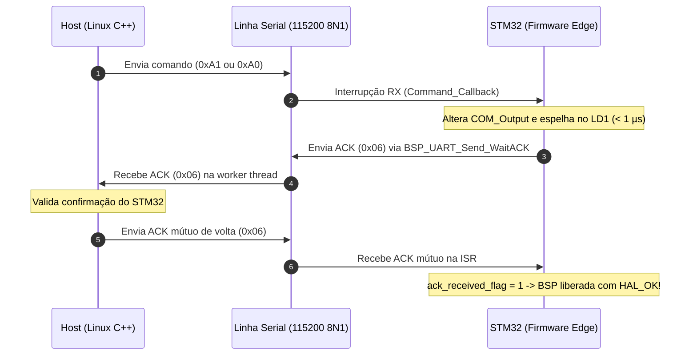

# STM32 UART Host Bridge

Biblioteca em **C++17** de alta performance para comunicação serial assíncrona com microcontroladores **STM32** no Linux, com controle de atuadores via hardware e handshake bidirecional com garantia de entrega (**ACK mútuo**).

---

## 📑 Sumário

- [Visão Geral e Arquitetura](#-visão-geral-e-arquitetura)
- [Como o Edge (Firmware STM32) Opera](#-como-o-edge-firmware-stm32-opera)
- [Como Adicionar a Biblioteca a Outro Projeto](#-como-adicionar-a-biblioteca-a-outro-projeto)
  - [Opção 1: CMake via `add_subdirectory` (Recomendado)](#opção-1-cmake-via-add_subdirectory-recomendado)
  - [Opção 2: Integração Direta dos Fontes](#opção-2-integração-direta-dos-fontes)
  - [Opção 3: Linkagem Estática (`libserial_lib.a`)](#opção-3-linkagem-estática-libserial_liba)
- [Como Importar e Utilizar o `Stm32Bridge`](#-como-importar-e-utilizar-o-stm32bridge)
  - [As Três Funções da Abstração](#as-três-funções-da-abstração)
  - [Exemplo Completo de Uso](#exemplo-completo-de-uso)
- [Contrato de Comunicação e Handshake Mútuo](#-contrato-de-comunicação-e-handshake-mútuo)

---

## 🧠 Visão Geral e Arquitetura

A biblioteca foi projetada segundo padrões modernos de engenharia de software em C++17 e sistemas embarcados Linux:

1. **Camada de Alto Nível (`Stm32Bridge`)**: Abstrai todo o subsistema serial em **três funções simples**, auto-detectando o microcontrolador via USB e gerenciando transações com handshake seguro.
2. **Fachada (`SerialClient`)**: Ponto central de abstração para gerenciamento de descritores de arquivo POSIX, ciclo de vida de threads e conexão.
3. **Driver POSIX Raw (`SerialPort`)**: Configura o terminal serial via `struct termios` em **Modo Raw** (8N1, 115200 bps, sem buffer canônico, sem eco, sem controle de fluxo) para garantir comunicação determinística de baixa latência.
4. **Worker Thread Assíncrono (`AsyncSerialReceiver`)**: Thread de segundo plano que monitora o descritor de arquivo através de multiplexação I/O (`poll()` com timeout de 100 ms), evitando consumo desnecessário de CPU (*busy-waiting*) e despachando dados aos observadores registrados.
5. **Padrão Observer (`ISerialObserver`)**: Interface desacoplada para notificação de chegada de bytes, erros e desconexão abrupta de cabo.
6. **Descoberta Dinâmica de Hardware (`PortEnumerator`)**: Varre o `/sys/class/tty/` via `std::filesystem`, ignorando consoles virtuais e identificando automaticamente o hardware ST-Link da STMicroelectronics (`VID: 0483`, `PID: 374b`).

---

## ⚡ Como o Edge (Firmware STM32) Opera

O microcontrolador roda uma implementação enxuta e determinística baseada na HAL do STM32 (testado na placa **NUCLEO-F767ZI**, mas compatível com qualquer família STM32 com UART):

### 1. Pinos de Hardware
- **`COM_Output` (`PF15`)**: Saída digital dedicada de controle externo.
- **`LD1` (`PB0`)**: LED verde da placa que **espelha fielmente o estado do pino `COM_Output`** em tempo real.

### 2. Comportamento Operacional
- **Comando "Objeto Encontrado" (`0xA1` ou `'1'`)**:
  - `COM_Output` é colocado imediatamente em **nível lógico baixo (`0` / `RESET`)**.
  - `LD1` é desligado (**`0` / `RESET`**).
- **Comando "Sem Objeto" (`0xA0` ou `'0'`)**:
  - `COM_Output` é levantado imediatamente para **nível lógico alto (`1` / `SET`)**.
  - `LD1` é ligado (**`1` / `SET`**).
- **Inicialização**: Ambos os pinos iniciam em nível lógico baixo (`0`).
- **Escopo Estrito**: Não há tarefas adicionais, botões concorrentes ou transmissões periódicas; o firmware atua exclusivamente sob demanda do Host.

---

## 📡 Contrato de Comunicação e Handshake Mútuo

A comunicação exige confirmação em ambos os sentidos para assegurar integridade contra perdas de pacotes:



| Comando / Sinal | Byte | Descrição | Ação no STM32 |
| :--- | :--- | :--- | :--- |
| `CMD_OBJETO_ENCONTRADO` | `0xA1` | Objeto detectado pelo Host | `COM_Output = 0`, `LD1 = 0` |
| `CMD_SEM_OBJETO` | `0xA0` | Ausência de objeto | `COM_Output = 1`, `LD1 = 1` |
| `BYTE_ACK` | `0x06` | Acknowledge (Handshake Mútuo) | Confirma processamento nos dois sentidos |

---

## 📦 Como Adicionar a Biblioteca a Outro Projeto

### Estrutura dos Arquivos da Biblioteca
Para utilizar em outro projeto (como um pipeline de visão computacional, nó ROS2 ou aplicação de controle), copie a pasta `host` ou apenas os diretórios `include/` e `src/`:

```text
seu_projeto/
├── CMakeLists.txt
├── src/
│   └── main.cpp                  # Sua aplicação
└── third_party/
    └── serial_lib/               # Diretório host desta biblioteca
        ├── CMakeLists.txt
        ├── include/
        │   ├── Stm32Bridge.hpp   # <- Interface unificada
        │   ├── SerialClient.hpp
        │   ├── SerialPort.hpp
        │   ├── SerialTypes.hpp
        │   ├── PortEnumerator.hpp
        │   ├── AsyncSerialReceiver.hpp
        │   ├── ISerialObserver.hpp
        │   └── MessageBufferObserver.hpp
        └── src/
            ├── Stm32Bridge.cpp
            ├── SerialClient.cpp
            ├── SerialPort.cpp
            ├── PortEnumerator.cpp
            ├── AsyncSerialReceiver.cpp
            └── MessageBufferObserver.cpp
```

---

### Opção 1: CMake via `add_subdirectory` (Recomendado)

No `CMakeLists.txt` do seu projeto:

```cmake
cmake_minimum_required(VERSION 3.10)
project(MinhaAplicacao CXX)

set(CMAKE_CXX_STANDARD 17)
set(CMAKE_CXX_STANDARD_REQUIRED ON)

# 1. Adiciona a pasta da biblioteca
add_subdirectory(third_party/serial_lib)

# 2. Cria seu executável
add_executable(minha_aplicacao src/main.cpp)

# 3. Linka com a serial_lib (inclui automaticamente os headers)
target_link_libraries(minha_aplicacao PRIVATE serial_lib)
```

---

### Opção 2: Integração Direta dos Fontes

Se preferir não usar `add_subdirectory`, adicione os fontes diretamente ao seu alvo:

```cmake
cmake_minimum_required(VERSION 3.10)
project(MinhaAplicacao CXX)

set(CMAKE_CXX_STANDARD 17)
set(CMAKE_CXX_STANDARD_REQUIRED ON)

find_package(Threads REQUIRED)

add_executable(minha_aplicacao
    src/main.cpp
    third_party/serial_lib/src/Stm32Bridge.cpp
    third_party/serial_lib/src/SerialClient.cpp
    third_party/serial_lib/src/SerialPort.cpp
    third_party/serial_lib/src/PortEnumerator.cpp
    third_party/serial_lib/src/AsyncSerialReceiver.cpp
    third_party/serial_lib/src/MessageBufferObserver.cpp
)

target_include_directories(minha_aplicacao PRIVATE third_party/serial_lib/include)
target_link_libraries(minha_aplicacao PRIVATE Threads::Threads)
```

---

### Opção 3: Linkagem Estática (`libserial_lib.a`)

Se compilar a biblioteca previamente:
```bash
cd host
mkdir build && cd build
cmake .. && make serial_lib
# Gera libserial_lib.a
```

Basta linkar no compilador:
```bash
g++ -std=c++17 main.cpp -Ipath/to/include -Lpath/to/build -lserial_lib -pthread -o minha_aplicacao
```

---

## 💻 Como Importar e Utilizar o `Stm32Bridge`

Basta incluir o cabeçalho `Stm32Bridge.hpp` e utilizar o namespace `bridge`.

### As Três Funções da Abstração

```cpp
#include "Stm32Bridge.hpp"

// 1. Conecta automaticamente buscando o STM32 (VID 0483 / PID 374b)
//    Opcionalmente aceita uma porta específica: bridge::conectar("/dev/ttyACM0")
bool bridge::conectar(const std::string& customPort = "");

// 2. Envia 0xA1, abaixa COM_Output/LD1 para 0 e executa o handshake bidirecional
bool bridge::enviar_objeto_encontrado();

// 3. Envia 0xA0, levanta COM_Output/LD1 para 1 e executa o handshake bidirecional
bool bridge::enviar_sem_objeto();

// Utilitários auxiliares:
void bridge::desconectar();
bool bridge::esta_conectado();
std::string bridge::obter_porta_conectada();
```

---

### Exemplo Completo de Uso

Abaixo está um exemplo típico de integração em uma aplicação (ex: detecção por câmera ou sensor):

```cpp
#include "Stm32Bridge.hpp"

#include <iostream>
#include <thread>
#include <chrono>

using namespace std::chrono_literals;

int main() {
    std::cout << "Iniciando comunicação com STM32...\n";

    // 1. Conexão automática (sem parâmetros)
    if (!bridge::conectar()) {
        std::cerr << "Erro: Microcontrolador STM32 não encontrado no barramento USB!\n";
        return 1;
    }

    std::cout << "Conectado na porta: " << bridge::obter_porta_conectada() << "\n";

    // 2. Simula detecção de objeto: COM_Output e LD1 vão para 0
    std::cout << "Objeto detectado! Enviando comando...\n";
    if (bridge::enviar_objeto_encontrado()) {
        std::cout << "-> Sucesso: STM32 confirmou e COM_Output está em 0.\n";
    } else {
        std::cerr << "-> Falha / Timeout no handshake do STM32.\n";
    }

    std::this_thread::sleep_for(3s);

    // 3. Simula ausência de objeto: COM_Output e LD1 voltam para 1
    std::cout << "Objeto removido! Enviando comando...\n";
    if (bridge::enviar_sem_objeto()) {
        std::cout << "-> Sucesso: STM32 confirmou e COM_Output está em 1.\n";
    } else {
        std::cerr << "-> Falha / Timeout no handshake do STM32.\n";
    }

    // 4. Encerramento seguro
    bridge::desconectar();
    std::cout << "Conexão encerrada com sucesso.\n";
    return 0;
}
```

---

## 🛠️ Permissões de Acesso no Linux

Para acessar as portas seriais (`/dev/ttyACM*` ou `/dev/ttyUSB*`) sem necessidade de `sudo`, certifique-se de que o usuário pertença ao grupo `dialout`:

```bash
sudo usermod -aG dialout $USER
```
*(Faça logoff e login novamente para ativar a permissão).*
