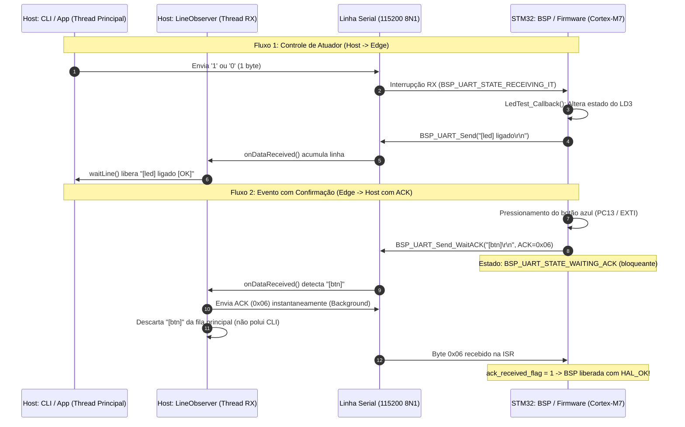

# STM32 UART Host Bridge

Sistema integrado de comunicação bidirecional via UART entre uma aplicação **Host (Linux / C++17)** e um microcontrolador **Edge (STM32 NUCLEO-F767ZI em C com STM32Cube HAL)**.

O projeto demonstra controle remoto de atuadores (LED), recebimento de eventos assíncronos de sensores/botões com garantia de entrega e controle de fluxo via protocolo de confirmação (**ACK**).

---

## 📐 Arquitetura do Sistema



---

## 🗂️ Estrutura do Repositório

```text
stm32-uart-host-bridge/
├── .gitignore          # Regras para artefatos CMake e STM32CubeIDE
├── README.md           # Documentação geral do sistema
├── host/               # Aplicação e Biblioteca C++ (Host Linux)
│   ├── CMakeLists.txt  # Script de build CMake
│   ├── example/        # CLI interativa (main.cpp)
│   ├── include/        # Headers da biblioteca (SerialClient, Observers, etc.)
│   └── src/            # Implementação de acesso POSIX/termios e threads
└── firmware/           # Projeto de Firmware STM32CubeIDE (Edge C)
    ├── Core/           # Código da aplicação e BSP (Bsp.h, Bsp.c, main.c)
    ├── Drivers/        # HAL STM32F7xx e CMSIS
    ├── .project        # Arquivo de projeto Eclipse / STM32CubeIDE
    └── teste serial.ioc # Configuração de pinos e periféricos CubeMX
```

---

## 📡 Contrato de Comunicação (Protocolo UART)

- **Parâmetros Físicos:** `115200 bps`, `8 bits de dados`, `sem paridade (None)`, `1 stop bit (8N1)`, sem controle de fluxo por hardware (`RTS/CTS off`).
- **Porta padrão ST-Link:** detectada automaticamente pelo Host via Vendor ID `0483` e Product ID `374b`.

| Origem | Destino | Pacote | Formato | Descrição |
| :--- | :--- | :--- | :--- | :--- |
| **Host** | **Edge** | `'1'` | 1 byte raw | Liga o LED verde da placa (`LD3` / `PB14`). |
| **Host** | **Edge** | `'0'` | 1 byte raw | Desliga o LED verde da placa (`LD3` / `PB14`). |
| **Edge** | **Host** | `"[led] ligado\r\n"` | ASCII | Notificação de status após execução de comando `'1'`. |
| **Edge** | **Host** | `"[led] desligado\r\n"` | ASCII | Notificação de status após execução de comando `'0'`. |
| **Edge** | **Host** | `"[btn]\r\n"` | ASCII | Sinalização de interrupção de botão de usuário (`USER_Btn` / `PC13`). Dispara espera por ACK. |
| **Host** | **Edge** | `0x06` | 1 byte binário (`ACK`) | Confirmação de recebimento injetada pelo Host na thread de RX para liberar o firmware. |

---

## 🚀 Como Executar

### 1. Firmware (STM32 Edge)

1. Abra o **STM32CubeIDE**.
2. Vá em **File > Import... > General > Existing Projects into Workspace**.
3. Selecione o diretório `firmware/` deste repositório e confirme.
4. Conecte sua placa **NUCLEO-F767ZI** via cabo USB (conector `CN1` / ST-LINK).
5. Compile e grave o firmware clicando em **Run** ou **Debug**.

### 2. Host (Aplicação C++ no Linux)

**Pré-requisitos:** `cmake` (>= 3.10), compilador compatível com C++17 (`g++` ou `clang++`), e bibliotecas `pthread`.

```bash
# Entre na pasta host
cd host

# Crie e acesse o diretório de compilação
mkdir build && cd build

# Gere os Makefiles e compile
cmake ..
cmake --build .

# Execute a aplicação (a porta do ST-Link é localizada automaticamente)
./serial_example
```

> **Dica:** Se desejar especificar uma porta manualmente:
> ```bash
> ./serial_example /dev/ttyACM0
> ```

---

## 💻 Interface Interativa (CLI)

Após iniciar o `serial_example`, você verá o prompt interativo:

```text
ST-Link encontrado: /dev/ttyACM0 (STMicroelectronics STM32 STLink)
Conectando em /dev/ttyACM0 @ 115200 8N1...

Comandos:
  1  -> liga LD3
  0  -> desliga LD3
  b  -> pisca LD3 5x
  q  -> sair

> 1
  STM32: [led] ligado  [OK]
> 0
  STM32: [led] desligado  [OK]
```

Se você pressionar fisicamente o **botão azul** da placa Nucleo (`B1`), a thread de recepção do Host responde instantaneamente:

```text
> 
[Background] Mensagem '[btn]' recebida do STM32. Enviando ACK (0x06) instantaneamente!
> 
```

O firmware é liberado imediatamente sem risco de timeout e sem poluir o buffer de comandos do usuário.

---

## 🛡️ Destaques de Engenharia

- **Não-bloqueio no Host:** A recepção de dados roda em thread própria (`AsyncSerialReceiver`) usando `poll()`. O envio de ACK ocorre nessa mesma thread com latência mínima.
- **Isolamento de Buffers:** Mensagens de controle como `[btn]` são consumidas antes de chegar à fila da aplicação principal, evitando falsos positivos no processamento de respostas do LED.
- **Robustez de BSP no STM32:** Máquina de estados que transita de forma segura entre `IDLE`, `RECEIVING_IT` e `WAITING_ACK`, prevenindo colisões entre interrupções e rotinas de envio.
