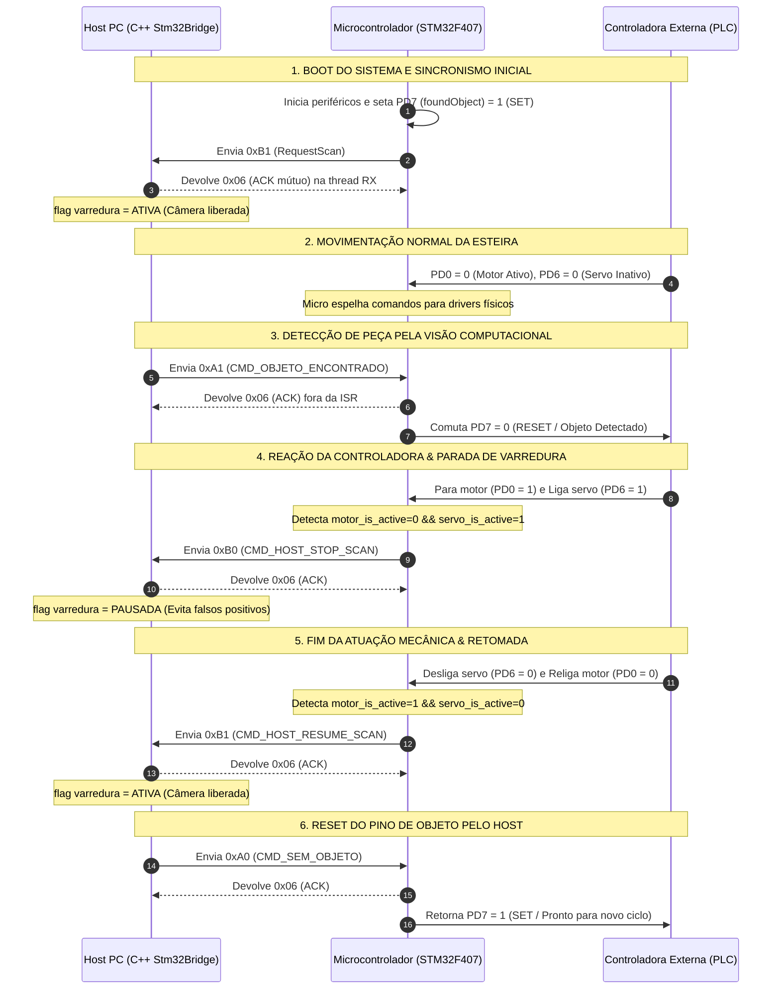

# STM32 UART Host Bridge

Sistema integrado de comunicação bidirecional de alta confiabilidade entre uma aplicação **Host (Linux / C++17)**, um microcontrolador **Edge (STM32F407VET6 em C com STM32Cube HAL)** e uma **Controladora Externa (PLC / Lógica Industrial)**.

O projeto foi projetado para células industriais de triagem e manipulação de peças, coordenando em tempo real esteira transportadora, servomotor e algoritmos de visão computacional/IA via protocolo serial assíncrono com garantia mútua de entrega (**Handshake ACK**).

---

## 📑 Sumário

- [1. Visão Geral do Sistema (Os 3 Agentes)](#1-visão-geral-do-sistema-os-3-agentes)
- [2. Protocolo de Comunicação e Fluxo Operacional](#2-protocolo-de-comunicação-e-fluxo-operacional)
  - [Tabela de Bytes do Protocolo](#tabela-de-bytes-do-protocolo)
  - [Diagrama de Sequência Completo](#diagrama-de-sequência-completo)
  - [Detalhamento do Ciclo de Operação](#detalhamento-do-ciclo-de-operação)
- [3. Camada Host C++ (`Stm32Bridge`)](#3-camada-host-c-stm32bridge)
  - [Arquitetura Interna do Driver Host](#arquitetura-interna-do-driver-host)
  - [Funções Disponíveis na `Stm32Bridge`](#funções-disponíveis-na-stm32bridge)
  - [Como Adicionar a Biblioteca a Outro Projeto](#como-adicionar-a-biblioteca-a-outro-projeto)
  - [Exemplo de Uso no Pipeline de Visão](#exemplo-de-uso-no-pipeline-de-visão)
- [4. Camada de Firmware (Documentação Dedicada)](#4-camada-de-firmware-documentação-dedicada)
- [5. Como Testar e Executar](#5-como-testar-e-executar)

---

## 1. Visão Geral do Sistema (Os 3 Agentes)

A automação é dividida em três camadas com papéis bem delimitados:

1. **Host PC (Visão Computacional / Inteligência Artificial):**
   - Executa a aplicação de controle de qualidade e inspeção visual (OpenCV, rede neural ou scripts).
   - Utiliza a biblioteca `Stm32Bridge` para gerenciar a porta serial em modo Raw assíncrono.
   - Controla o disparo de comandos de detecção (`0xA1` / `0xA0`) e reage pausando/retomando o processamento de imagens conforme o estado da varredura (`StopScan` / `ResumeScan`).
2. **Microcontrolador (Ponte Hardware - STM32F407VET6):**
   - Lê os sinais de comando da controladora externa com debounce unificado de 10 ms.
   - Atua nos drivers físicos de potência (pulsos de passo do motor via Timer 3 e sinal PWM do servo via Timer 4).
   - Sinaliza à controladora a detecção de peças através do pino `foundObject` (`PD7`).
   - Monitora transições entre motor e servo para sincronizar o fluxo da câmera do Host.
3. **Controladora Externa (PLC / Lógica Industrial):**
   - Coordena o avanço da esteira mecânica através dos pinos de entrada do microcontrolador.
   - Ao receber o sinal de objeto encontrado (`PD7 == 0`), comanda a parada da esteira e o acionamento do atuador servo para manuseio da peça.

---

## 2. Protocolo de Comunicação e Fluxo Operacional

- **Interface Física:** USART1 (`PA9` = TX, `PA10` = RX).
- **Parâmetros Seriais:** `115200 bps`, `8 bits de dados`, `sem paridade (None)`, `1 stop bit (8N1)`, sem controle de fluxo por hardware (`RTS/CTS off`).
- **Timeout Máximo de Espera do ACK:** `50 ms`.

### Tabela de Bytes do Protocolo

| Byte Hex | Decimal | Constante no Código | Sentido | Descrição | Ação / Comportamento |
| :---: | :---: | :--- | :---: | :--- | :--- |
| **`0xB1`** | `177` | `CMD_HOST_RESUME_SCAN`<br>`CMD_HOST_REQUEST_SCAN` | **Micro $\rightarrow$ Host** | Retomada / Solicitação de Varredura | Disparado no boot e após o término da atuação do servo com retorno do motor. Host seta flag de varredura para **ATIVA**. *(Espera ACK 0x06)* |
| **`0xB0`** | `176` | `CMD_HOST_STOP_SCAN` | **Micro $\rightarrow$ Host** | Parada da Varredura | Disparado quando a controladora para o motor e aciona o servo. Host seta flag de varredura para **PAUSADA**. *(Espera ACK 0x06)* |
| **`0xA1`** | `161` | `CMD_OBJETO_ENCONTRADO`<br>*(ou char `'1'`)* | **Host $\rightarrow$ Micro** | Objeto Detectado pela Câmera | Micro coloca o pino `foundObject` (`PD7`) em nível **`0` (RESET)**. *(Espera ACK 0x06)* |
| **`0xA0`** | `160` | `CMD_SEM_OBJETO`<br>*(ou char `'0'`)* | **Host $\rightarrow$ Micro** | Sem Objeto / Reset de Detecção | Micro coloca o pino `foundObject` (`PD7`) em nível **`1` (SET)**. *(Espera ACK 0x06)* |
| **`0x06`** | `6` | `BYTE_ACK`<br>`HOST_EXPECTED_ACK` | **Bidirecional** | Confirmação de Entrega (ACK) | Resposta imediata injetada pelo receptor ao validar o comando, liberando o transmissor. |

---

### Diagrama de Sequência Completo



---

### Detalhamento do Ciclo de Operação

1. **Primeira Comunicação (Boot):**
   - Ao ligar, o microcontrolador executa `BSP_InitAPP()`, garante o pino `foundObject` (`PD7`) em nível `1` (sem objeto) e dispara imediatamente `BSP_HostRequestScan()` transmitindo o byte `0xB1`.
   - O Host recebe o byte via thread em background (`BridgeObserver`), devolve `0x06` (ACK) e marca a flag interna de varredura como **ativa**.
2. **Varredura Normal:**
   - A controladora mantém o motor ativo (`PD0 = 0`) e o servo desligado (`PD6 = 0`). O firmware aplica debounce de 10 ms e atualiza os drivers de potência.
   - O pipeline de visão do Host realiza a busca por peças.
3. **Detecção e Sinalização:**
   - Ao detectar uma peça, o Host chama `bridge::enviar_objeto_encontrado()`, transmitindo `0xA1`.
   - O STM32 recebe o byte via interrupção UART, processa no loop principal devolvendo o `0x06` (ACK) e comuta `foundObject` (`PD7`) para `0` (nível baixo).
4. **Parada de Varredura (StopScan):**
   - Ao perceber `PD7 == 0`, a controladora para o motor (`PD0 = 1`) e aciona o servo (`PD6 = 1`).
   - O microcontrolador detecta a combinação `!motor_is_active && servo_is_active` e envia `0xB0` (`CMD_HOST_STOP_SCAN`) ao Host.
   - O Host responde instantaneamente com `0x06` (ACK) e pausa o processamento visual da câmera.
5. **Retomada de Varredura (ResumeScan):**
   - Concluído o tempo de manipulação da peça, a controladora desativa o servo (`PD6 = 0`) e reativa o motor (`PD0 = 0`).
   - O microcontrolador detecta `motor_is_active && !servo_is_active` e envia `0xB1` (`CMD_HOST_RESUME_SCAN`) ao Host.
   - O Host responde com `0x06` (ACK) e reativa a busca visual.
6. **Regra Estrita de Reset do Pino `PD7`:**
   - O pino `foundObject` (`PD7`) **NUNCA** é resetado automaticamente por tempo nem pela controladora; ele retorna para nível `1` (SET) **exclusivamente sob comando do Host** ao enviar `0xA0` (`CMD_SEM_OBJETO`).

---

## 3. Camada Host C++ (`Stm32Bridge`)

A camada Host é construída em **C++17 puro** com dependências padrão do sistema operacional POSIX (Linux) e threads nativas (`std::thread`, `poll`).

### Arquitetura Interna do Driver Host

```text
Stm32Bridge (Interface Unificada de Alto Nível)
 └── BridgeManager (Singleton RAII)
      ├── SerialClient (Fachada POSIX)
      │    ├── SerialPort (termios em Modo Raw: 115200 8N1)
      │    └── AsyncSerialReceiver (Worker Thread com poll())
      ├── BridgeObserver (Implementa ISerialObserver)
      │    ├── Intercepta 0xB0 / 0xB1 e injeta ACK (0x06) instantaneamente
      │    └── Gerencia atomicamente a flag de varredura (m_scanActive)
      └── PortEnumerator (Descoberta automática via /sys/class/tty/)
```

---

### Funções Disponíveis na `Stm32Bridge`

Todas as funções residem no namespace `bridge` (cabeçalho `host/include/Stm32Bridge.hpp`):

| Função | Parâmetros | Retorno | Descrição |
| :--- | :--- | :---: | :--- |
| `bridge::conectar(customPort)` | `const std::string& customPort = ""` | `bool` | Conecta ao STM32. Se vazio, varre `/sys/class/tty/` e busca automaticamente o hardware ST-Link (`VID: 0483`, `PID: 374b`). Retorna `true` no sucesso. |
| `bridge::enviar_objeto_encontrado()` | *Nenhum* | `bool` | Envia `0xA1` (`CMD_OBJETO_ENCONTRADO`), aguarda o ACK (`0x06`) do STM32 e conclui com o envio do ACK mútuo de volta. Timeout de 500 ms com até 3 tentativas. |
| `bridge::enviar_sem_objeto()` | *Nenhum* | `bool` | Envia `0xA0` (`CMD_SEM_OBJETO`), aguarda o ACK (`0x06`) do STM32 e conclui com o envio do ACK mútuo de volta. Destrava o pino `PD7`. |
| `bridge::esta_varredura_ativa()` | *Nenhum* | `bool` | **Thread-safe:** Retorna `true` se a varredura estiver autorizada (`ResumeScan`/`RequestScan` ativo) e `false` se estiver pausada pelo micro (`StopScan`). |
| `bridge::desconectar()` | *Nenhum* | `void` | Encerra a conexão serial, interrompe a thread do receptor e fecha os descritores de arquivo (RAII). |
| `bridge::esta_conectado()` | *Nenhum* | `bool` | Verifica se o descritor serial e o observador estão ativos. |
| `bridge::obter_porta_conectada()` | *Nenhum* | `std::string` | Retorna o caminho absoluto do dispositivo conectado (ex: `"/dev/ttyACM0"`). |

#### Aliases de Conveniência
- `bridge::isScanActive()` $\rightarrow$ equivalente a `bridge::esta_varredura_ativa()`
- `bridge::is_scan_active()` $\rightarrow$ equivalente a `bridge::esta_varredura_ativa()`
- `bridge::enviarObjetoEncontrado()` $\rightarrow$ equivalente a `bridge::enviar_objeto_encontrado()`
- `bridge::enviarSemObjeto()` $\rightarrow$ equivalente a `bridge::enviar_sem_objeto()`

---

### Como Adicionar a Biblioteca a Outro Projeto

A pasta `host/` foi estruturada para ser consumida como submódulo ou pasta de terceiros (`third_party/serial_lib`).

#### Estrutura Mínima Necessária
```text
seu_projeto/
├── CMakeLists.txt
├── src/
│   └── main.cpp
└── third_party/
    └── serial_lib/               # Conteúdo da pasta host/
        ├── CMakeLists.txt
        ├── include/
        │   ├── Stm32Bridge.hpp   # <- Interface principal
        │   ├── SerialClient.hpp
        │   ├── SerialPort.hpp
        │   ├── AsyncSerialReceiver.hpp
        │   ├── ISerialObserver.hpp
        │   ├── PortEnumerator.hpp
        │   └── SerialTypes.hpp
        └── src/
            ├── Stm32Bridge.cpp
            ├── SerialClient.cpp
            ├── SerialPort.cpp
            ├── AsyncSerialReceiver.cpp
            ├── MessageBufferObserver.cpp
            └── PortEnumerator.cpp
```

#### Opção A: CMake via `add_subdirectory` (Recomendado)
No seu `CMakeLists.txt`:
```cmake
cmake_minimum_required(VERSION 3.10)
project(CameraPipeline CXX)

set(CMAKE_CXX_STANDARD 17)
set(CMAKE_CXX_STANDARD_REQUIRED ON)

# 1. Adiciona a biblioteca serial
add_subdirectory(third_party/serial_lib)

# 2. Seu executável
add_executable(meu_detector src/main.cpp)

# 3. Linka com a biblioteca (os includes são importados automaticamente)
target_link_libraries(meu_detector PRIVATE serial_lib)
```

#### Opção B: Inclusão Direta dos Fontes
Se não quiser usar `add_subdirectory`:
```cmake
add_executable(meu_detector
    src/main.cpp
    third_party/serial_lib/src/Stm32Bridge.cpp
    third_party/serial_lib/src/SerialClient.cpp
    third_party/serial_lib/src/SerialPort.cpp
    third_party/serial_lib/src/AsyncSerialReceiver.cpp
    third_party/serial_lib/src/MessageBufferObserver.cpp
    third_party/serial_lib/src/PortEnumerator.cpp
)

target_include_directories(meu_detector PRIVATE third_party/serial_lib/include)
find_package(Threads REQUIRED)
target_link_libraries(meu_detector PRIVATE Threads::Threads)
```

---

### Exemplo de Uso no Pipeline de Visão

```cpp
#include "Stm32Bridge.hpp"
#include <iostream>
#include <thread>
#include <chrono>

int main() {
    // 1. Conecta automaticamente buscando o ST-Link do STM32
    if (!bridge::conectar()) {
        std::cerr << "Falha ao conectar com o STM32!" << std::endl;
        return 1;
    }

    std::cout << "Conectado em: " << bridge::obter_porta_conectada() << std::endl;

    // Loop do pipeline de visão / IA
    while (bridge::esta_conectado()) {
        // 2. Consulta se a varredura está liberada pelo microcontrolador
        if (!bridge::esta_varredura_ativa()) {
            // A esteira está parada e o servo está manipulando a peça anterior
            std::this_thread::sleep_for(std::chrono::milliseconds(20));
            continue;
        }

        // 3. Captura frame da câmera e roda inferência do modelo
        bool peca_detectada = false; /* ... sua lógica de visão aqui ... */

        if (peca_detectada) {
            std::cout << "Peça detectada! Notificando STM32..." << std::endl;

            // 4. Envia sinal de objeto encontrado com handshake ACK
            if (bridge::enviar_objeto_encontrado()) {
                std::cout << "Pino foundObject acionado no STM32 com sucesso!" << std::endl;
            }

            // O STM32 e a controladora agora vão parar a esteira e mover o servo.
            // O próprio BridgeObserver receberá o StopScan (0xB0) em background
            // e mudará esta_varredura_ativa() para false.
        }

        std::this_thread::sleep_for(std::chrono::milliseconds(10));
    }

    bridge::desconectar();
    return 0;
}
```

---

## 4. Camada de Firmware (Documentação Dedicada)

Todas as informações técnicas de baixo nível da placa STM32F407VET6 estão documentadas detalhadamente em:

👉 **Consulte [firmware/README.md](firmware/README.md)** para:
- Funcionamento detalhado dos módulos de firmware (`main.c`, `bsp.c`, `bsp.h`, `UartHandler.c`).
- Tabela completa de mapeamento de pinos, modos GPIO, periféricos (TIM3, TIM4, USART1) e tags do CubeMX.
- Relação e especificação de todas as funções pendentes de implementação na BSP (`BSP_InitMotor`, `BSP_SetMotorSpeed`, `BSP_SetMotorDir`, `BSP_StartMotor`, `BSP_StopMotor`, `BSP_InitServo`, `BSP_StartServo`, `BSP_StopServo`).

---

## 5. Como Testar e Executar

Consulte o exemplo interativo de terminal CLI em `host/example/demo_bridge.cpp`:

```bash
cd host
mkdir -p build && cd build
cmake ..
cmake --build .

# Executa o terminal interativo da Bridge
./bridge_example
```

No terminal, utilize os comandos:
- `1` / `obj`: envia comando de objeto encontrado (`0xA1`).
- `0` / `sem`: reseta a flag de objeto encontrado (`0xA0`).
- `v` / `scan`: consulta o status da varredura (`bridge::esta_varredura_ativa()`).
- `s` / `status`: exibe status completo da porta serial e mapeamento de opcodes.
- `t` [N]: executa teste de benchmark de latência RTT em N iterações.
